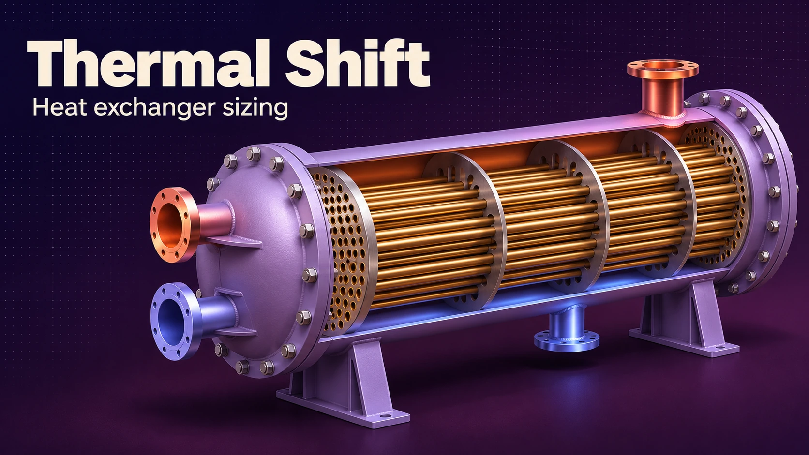

# Thermal Shift

A responsive heat exchanger sizing studio built with Next.js, TypeScript and Tailwind CSS.

Enter both inlet temperatures, mass flow rates, specific heat capacities, an overall heat transfer coefficient and either outlet target. Compare ideal countercurrent and parallel flow, inspect the calculated outlet, duty, log mean temperature difference and required area, and read stream temperatures along the cumulative duty axis.

## Run

Use Node.js 22 LTS and run `npm ci`, then `npm run dev`. Run `npm test` for the analytical checks and `npm run build` for a static export in `out/`.

## Model

Steady, single-phase sensible heat transfer with constant properties, constant U, and negligible external losses. The energy balance uses kg/s and kJ/(kg·K) to obtain duty in kW. Area uses duty in W and U in W/(m²·K). Zero or negative terminal approaches are flagged. The equipment illustration is a cutaway; multipass geometry correction and mechanical design are outside this model.

[Heat exchanger fundamentals, MIT](https://web.mit.edu/16.unified/www/SPRING/thermodynamics/notes/node131.html)

Built by [eladebaboulbaba.com](https://eladebaboulbaba.com).
